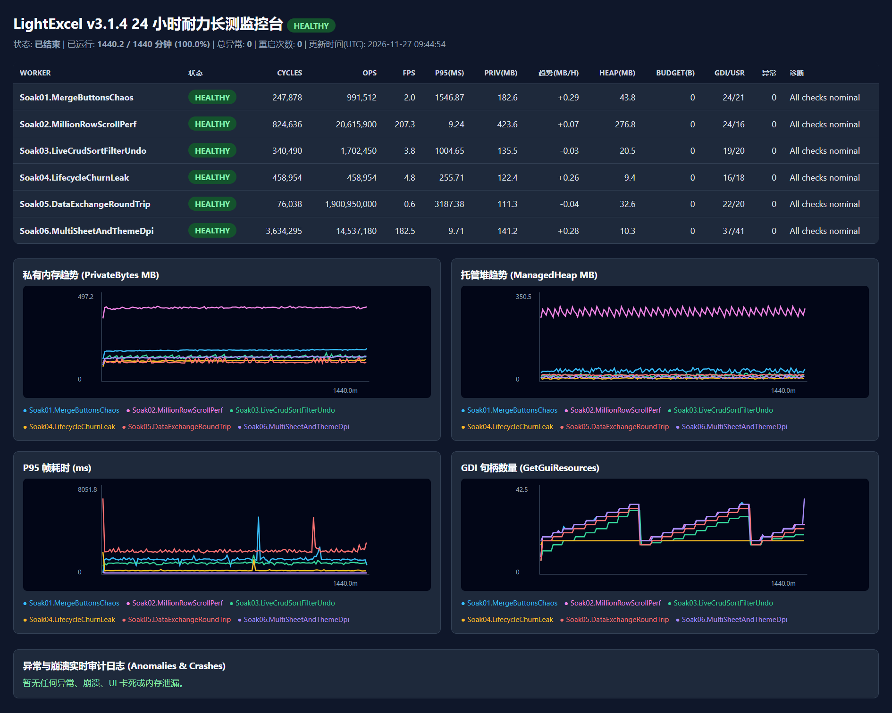

# LightExcel.StandardWpf

`LightExcel.StandardWpf` 是 `LightExcel.Core` 和 `LightExcel.DataExchange` 两个 NuGet 包的 WPF 演示项目。

- `LightExcel.Core` 提供 `SpreadsheetVisual` 表格控件，以及多级表头、排序、筛选和分页等功能。[NuGet 包](https://www.nuget.org/packages/LightExcel.Core/)
- `LightExcel.DataExchange` 提供流式 XLSX 和 CSV 导入导出，支持导出当前视图或全部源数据，以及在 XLSX 中保留多级表头和单元格合并。[NuGet 包](https://www.nuget.org/packages/LightExcel.DataExchange/)

## 演示内容

项目内置 4 个可交互实战页面，涵盖 LightExcel 3.1.17 全部核心能力：

- **订单表格 · 三级表头**：使用 MVVM 将 10 万行 SQLite 模拟订单绑定到 `SpreadsheetVisual`，完整提供实时开关栏（只读整行 / 允许选中 / 多选行 / 复制粘贴 / 排序 / 筛选 / 列设置菜单 / 拖列 / 调宽 / 行号 / Ctrl+F 查找 / 查询索引 / 冻结列 / 深浅主题切换）、**`CellsMerging` 自定义拦截钩子**、**代码流式合并求和（Sum / Average / Compute）与二维 Grid 矩形合并**、自动跟随主题的标准表头/行右键菜单、以及 XLSX / CSV 导入导出与合并视图导出。
- **全字段订单 · 100 列**：复用同一页面代码承载 100 列 × 200 万行宽表大数据集。
- **LRU 分页 · 千万行**：`PagedSheetDataSource` 千万级超大数据按需分页与极速双向滚动演示。
- **星号列宽 · 格内控件 · 合并**：纯 MVVM 演示 `Width="*"` / `100*` 比例列宽自适应、Apple 风格日历弹窗、零开销格内控件（文本 / `SheetButtonColumn` 快捷按钮 / 下拉选择 / 日期选择 / 勾选框 / 滑动开关 / 进度条 / `SheetImageColumn` 异步缩略图）、全面开放的 `SheetTemplateColumn` 视口虚拟化自定义 WPF 模板、控件列分组合并联动、实时动态汇总行以及自动换肤标准右键菜单。

## 24 小时耐力测试

3.1.17 NuGet 包随附一份标题标注 **v3.1.4** 的耐力测试报告。该次测试持续 **1,440.15 分钟**，6 个测试进程并发。报告记录 **0 个异常、0 次重启**。各场景的计数合计 **1,939,255,996**，其中包括导入导出的单元格计数。

| 测试场景 | 累计计数 | 报告中的结果 |
| --- | ---: | --- |
| 单元格合并与格内按钮 | 991,512 次操作 | 247,878 轮 |
| 百万行滚动 | 20,615,900 次操作 | 结束快照 207.3 FPS，P95 9.24 ms |
| 数据增删改、排序、筛选与撤销 | 1,702,450 次操作 | 340,490 轮 |
| 控件创建与销毁 | 458,954 次循环 | GDI 句柄 16 → 16 |
| XLSX 与合并结构往返 | 1,900,950,000 个单元格 | 76,038 轮 |
| 多表、主题与 DPI 切换 | 14,537,180 次操作 | 3,634,295 轮 |

HTML 监控台下载后可用浏览器打开，包含完整趋势图和结束快照。[HTML 监控台](docs/endurance-24h-report/24h-endurance-dashboard.html) · [原始 JSON](docs/endurance-24h-report/24h-endurance-report.json)

## 快速开始

需要 Windows x64 和 .NET 10 SDK。

1. 在 Visual Studio 打开 `LightExcel.StandardWpf.slnx`，还原 NuGet 包并生成项目。
2. 下载并解压基础示例库。将 `corrugated.db` 放入 `LightExcel.StandardWpf.exe` 同级的 `data` 文件夹。如果文件夹不存在，先新建它。
3. 启动程序，点击「加载数据库订单」。如果要运行 200 万行压测，将 `corrugated-2m.db` 也放到同一个 `data` 文件夹，重新启动程序后打开「全字段订单 · 100 列」。

## 数据库下载

- **基础示例库**包含 10 万行订单，启动程序需要它。[下载 `corrugated.zip`（约 14 MiB）](https://github.com/hu-xiao-tian/LightExcel.StandardWpf/releases/download/test-data-corrugated-2m/corrugated.zip)
- **可选压测库**包含 200 万行订单，用于大容量数据演示。[下载 `corrugated-2m.zip`（约 283 MiB）](https://github.com/hu-xiao-tian/LightExcel.StandardWpf/releases/download/test-data-corrugated-2m/corrugated-2m.zip)

## 文档

- 查看如何把 LightExcel 加入自己的 WPF 项目。[接入说明](使用说明.md)
- 查阅表格功能、属性和用法。[使用手册](使用手册.md)

本项目采用 Apache 2.0 许可证。[查看许可证](LICENSE)
